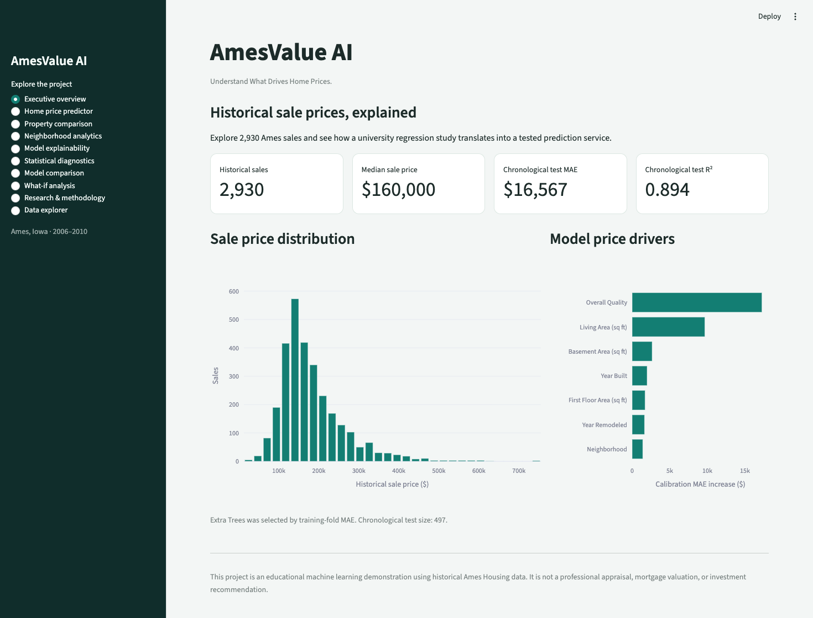
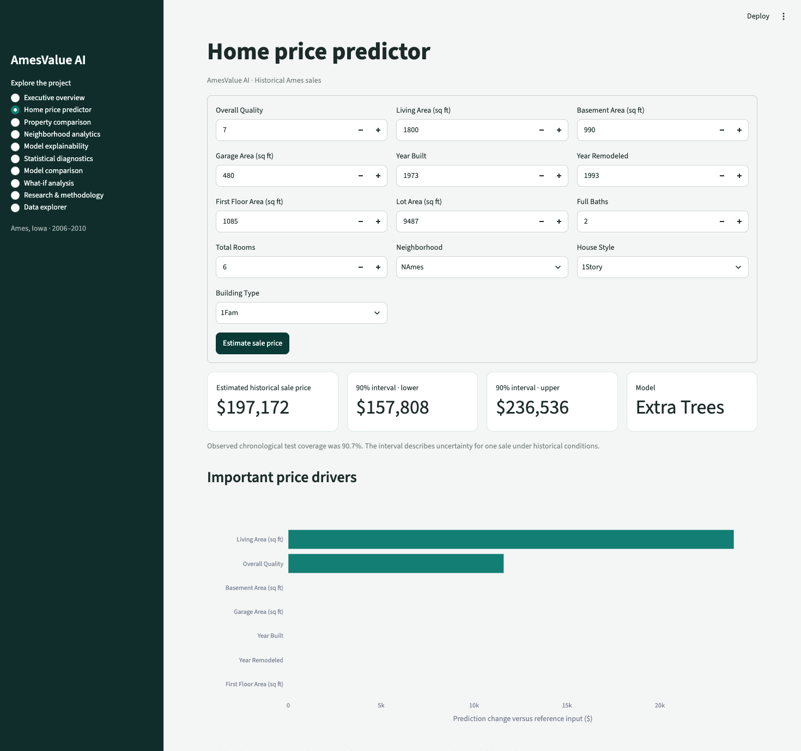
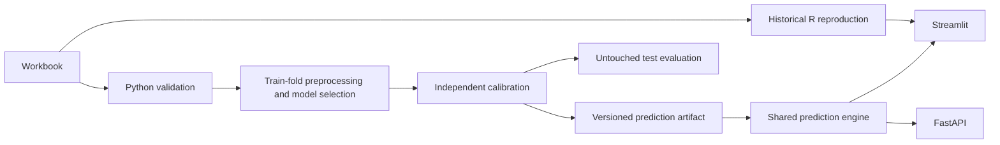

# AmesValue AI

**Explainable Real Estate Price Prediction & Analytics**

AmesValue AI reproduces a university regression study in R and turns it into a testable Python valuation demo for historical Ames, Iowa sales. Explore price drivers, compare hypothetical homes, inspect diagnostics and request predictions with uncertainty intervals.





## Results

| Evaluation | Training criterion | Model | Test sales | Test MAE | Test RMSE | Dollar R² |
|---|---|---|---:|---:|---:|---:|
| Chronological | Rolling CV MAE | **Extra Trees** | 497 | **$16,567** | $24,417 | **0.894** |
| Random | Grouped CV MAE | Stepwise AIC | 586 | $21,671 | $100,480 | −0.397 |

The app serves the rolling-validation winner. Its 90% conformal interval covered **90.7%** of later test sales, with mean width **$78,728**. On the random split, an atypically large home exposed the extrapolation risk of the log-linear benchmark. [Validation and interval details](docs/model_validation.md) · [All 16 candidate results](results/model_comparison.csv)

The original MAT 326 analysis modeled 2,904 complete and filtered sales. Its Stepwise AIC model reproduced **adjusted log R² of 0.886**, **AIC of −3215.0**, and **43 coefficients**. Those values describe historical fit. The new holdouts retain the historically excluded sales and report errors in nominal dollars. [Original research and discrepancies](docs/original_research.md)

## Architecture



The original workbook contains **2,930 residential sales and 82 fields**. Models use 13 structural and neighborhood inputs. The suite covers mean and median, raw and log OLS, Ridge, Lasso, Elastic Net, grouped Stepwise AIC and Backward BIC, quality × neighborhood, Random Forest, HistGradientBoosting, Extra Trees and XGBoost. Log predictions compare naive, smearing and normal corrections. [Data dictionary and attribution](data/README.md) · [Methodology](docs/methodology.md)

## Run locally

Python 3.11+ is required. Install optional XGBoost for the full candidate suite. XGBoost on macOS may require the OpenMP runtime. The bundled Extra Trees model can serve predictions immediately.

```bash
python -m venv .venv
source .venv/bin/activate
python -m pip install -e '.[dev,boost]'
streamlit run dashboard/app.py
uvicorn api.main:app --port 8000
```

Run the final two commands in separate terminals. The dashboard normally opens on port 8501, and FastAPI exposes interactive OpenAPI docs at `http://localhost:8000/docs`.

### Rebuild with the original workbook

Place the workbook at `data/raw/AmesHousing.xls`. See the data documentation for the publisher's download and attribution. Run these commands from the repository root.

```bash
python scripts/prepare_data.py
python scripts/train_models.py
python scripts/evaluate_models.py
python scripts/generate_reports.py
```

The local workbook enables the records explorer, historical comparables, PDP/ICE and holdout scatterplots. Public Git excludes the workbook and record-level outputs because redistribution rights for the workbook could not be verified.

### Reproduce MAT 326

With R and `renv` installed, run the following from the repository root.

```bash
Rscript -e 'renv::restore(prompt = FALSE)'
Rscript -e 'renv::load(); source("research/original_R_analysis.R", echo = FALSE, print.eval = TRUE)'
```

The script writes CSV tables and a multipage PDF of figures under `results/original_reproduction`. A local run also enables historical scatter diagnostics in Streamlit.

## Dashboard and API

The dashboard has ten views covering the executive overview, prediction, property comparison, neighborhood history and adjusted effects, global and local explainability, statistical diagnostics, model comparison, what-if scenarios, research and historical data exploration.

| Method | Endpoint | Output |
|---|---|---|
| GET | `/health` | Artifact readiness |
| GET | `/model-info` | Serving model, interval level and example inputs |
| POST | `/predict`, `/predict-interval` | Estimate, interval and model |
| POST | `/batch-predict` | Up to 100 estimates |
| POST | `/compare-properties` | Estimates, dollar differences and local drivers |
| GET | `/model-metrics` | Random and chronological CV and test results |
| GET | `/feature-importance` | Calibration permutation importance |
| GET | `/neighborhood-summary` | Aggregated historical sales statistics |

Copy the `defaults` object from `GET /model-info` as a first prediction request body. Batch and comparison endpoints accept arrays of those objects.

## Deployment and checks

Run `docker compose up --build` to launch both services using the read-only results mount. For Streamlit Community Cloud, select `dashboard/app.py` and Python 3.13. The bundled model and aggregate summaries power the predictor without R. Record-level views require local data. A deployed URL will exist only after the app is published.

```bash
ruff check .
pytest
```

Stack includes Python, R, pandas, NumPy, SciPy, scikit-learn, statsmodels, XGBoost, Pydantic, FastAPI, Streamlit, Plotly, Docker and GitHub Actions. Automated tests cover the serving contract, interval calibration, split isolation and dashboard workflows when artifacts are available.

## Scope and limitations

This project is an educational machine learning demonstration using historical Ames Housing data. It is not a professional appraisal, mortgage valuation, or investment recommendation.

Neighborhood associations are observational. Accuracy and coverage vary across groups, especially for sparse neighborhoods and unusual properties. Future work could test newer external data, investigate drift and compare adaptive conformal methods. [Responsible use](docs/limitations.md) · [Interview notes](docs/resume_bullets.md)

**Youssef Rafik** · Southern Connecticut State University · Spring 2026 original research · [GitHub profile](https://github.com/youssefrafik6)

[Publication handoff](docs/publication.md)

[Verification record](docs/verification.md)
