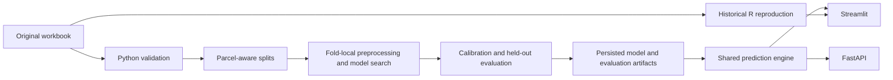

# Architecture

R and Python read the same source independently. Joblib artifacts are trusted local build outputs. Keep training and serving on the same scikit-learn version. The API and Streamlit use one Pydantic property contract and the same artifact. Service startup loads the artifact when first needed; inference performs no fitting. Rebuild and restart both services after changing a model. The API is intended for local use and has no user accounts or request storage.
